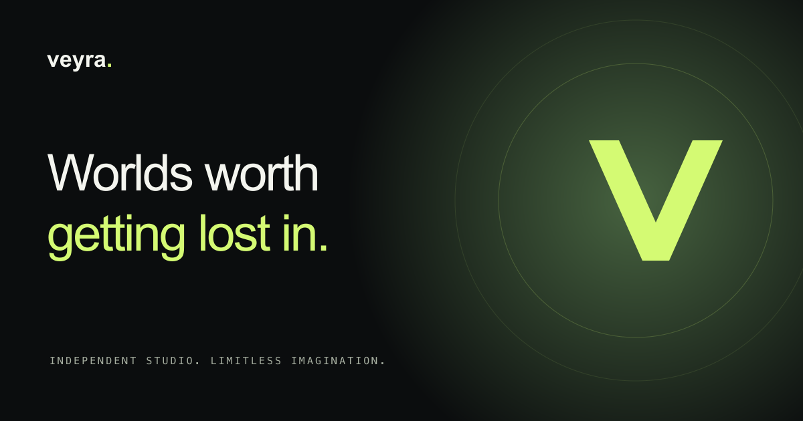
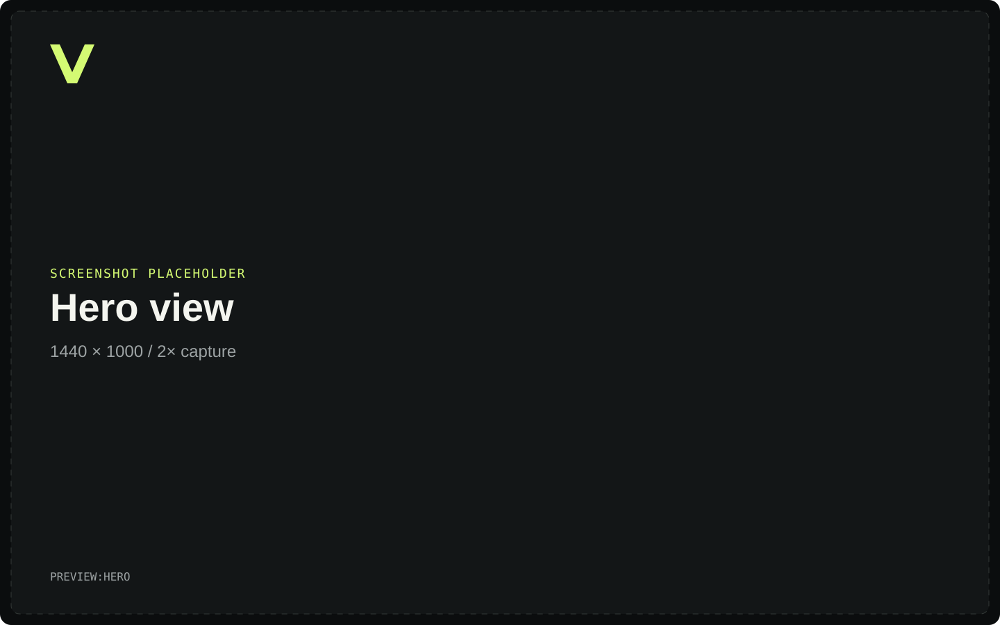
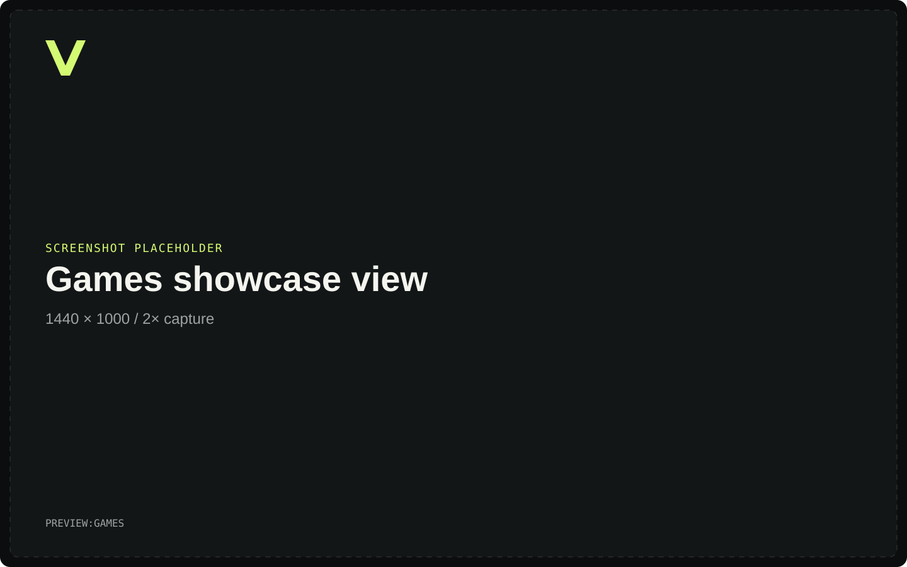
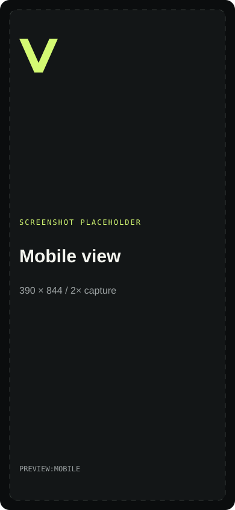

<div align="center">

# Veyra Interactive

### Gaming Studio Showcase

**Worlds worth getting lost in.**

A cinematic gaming studio and publisher showcase built with Next.js App Router, TypeScript, Tailwind CSS, and Framer Motion. A modular starting point for game collections, independent studios, and creative portfolios.

[](https://nextjs.org/)
[](https://react.dev/)
[](https://www.typescriptlang.org/)
[](https://tailwindcss.com/)
[](https://motion.dev/)
[](LICENSE)

[Live demo](#live-demo) · [Features](#features) · [Getting started](#getting-started) · [Previews](#screenshots-and-previews) · [Portfolio](https://lunanezha.com/) · [LinkedIn](https://www.linkedin.com/in/luna-nezha/)



</div>

> Veyra, its games, team, and job openings are fictional portfolio concepts. The newsletter demonstrates validation and success states without collecting or sending email.

## Live demo

**Deployment URL:** `{{LIVE_DEMO_URL}}`

A deployment URL has not been configured in this repository. After publishing the site, replace this placeholder and the header’s **Live demo** link with the actual HTTPS URL. Set the same origin as `NEXT_PUBLIC_SITE_URL` before building.

## Features

- **Cinematic hero:** original concept artwork, animated atmosphere, pause control, and clear calls to action.
- **Game collection:** PC, console, and mobile filters, hover previews, status badges, and game detail dialogs.
- **Studio storytelling:** technology capabilities, creative values, and an illustrative team section.
- **Interactive careers:** department filters, expandable role descriptions, and concept-role dialogs.
- **Newsletter demo:** native email validation, an announced success state, and a reset action.
- **Responsive interaction:** mobile navigation, keyboard focus management, skip link, and live reduced-motion preferences.
- **Coordinated branding:** original SVG mark and favicon, Apple icon, and a 1200 × 630 social preview.
- **Modular source:** typed content, reusable UI primitives, local fonts, optimized images, and shared design tokens.

## Screenshots and previews

The following images are labeled placeholders, not screenshots of the running application. Replace them with browser captures using the slots below.

### Hero view

<!-- PREVIEW:HERO:START -->



<!-- PREVIEW:HERO:END -->

### Games showcase view

<!-- PREVIEW:GAMES:START -->



<!-- PREVIEW:GAMES:END -->

### Mobile view

<!-- PREVIEW:MOBILE:START -->



<!-- PREVIEW:MOBILE:END -->

| Placeholder tag  | Suggested replacement          | Browser viewport | Capture                                                 |
| ---------------- | ------------------------------ | ---------------- | ------------------------------------------------------- |
| `PREVIEW:HERO`   | `docs/screenshots/hero.webp`   | 1440 × 1000      | Header, hero headline, CTAs, artwork, and stats         |
| `PREVIEW:GAMES`  | `docs/screenshots/games.webp`  | 1440 × 1000      | `/games`, with all titles and platform controls visible |
| `PREVIEW:MOBILE` | `docs/screenshots/mobile.webp` | 390 × 844        | Landing page, with navigation closed                    |

Capture from a production build with browser zoom at 100%, fonts and images loaded, and reduced motion enabled for consistent frames. Use a device pixel ratio of 2 for sharp captures. Crop deliberately, avoid browser chrome and development overlays, optimize to WebP or PNG, and update each image path while preserving its alt text. Keep the `PREVIEW:*` comment markers as stable replacement slots.

## Getting started

### Prerequisites

- Node.js **22 or later**, as declared in `package.json`.
- npm and Git.

### Local setup

```sh
git clone https://github.com/LunaNezha/gc-capital-framer.git
cd gc-capital-framer
npm install
cp .env.example .env.local
npm run dev
```

Open [localhost:3000](http://localhost:3000). The environment file is optional for local exploration; no external service credentials are required. For a reproducible install from the lockfile, use `npm ci` instead of `npm install`.

### Commands

| Command                | Purpose                                                         |
| ---------------------- | --------------------------------------------------------------- |
| `npm run dev`          | Start the development server                                    |
| `npm run check`        | Run ESLint, route generation, TypeScript, and formatting checks |
| `npm run lint`         | Lint with zero warnings allowed                                 |
| `npm run typecheck`    | Generate Next.js route types and run TypeScript                 |
| `npm run format`       | Format supported files                                          |
| `npm run format:check` | Check formatting without writing changes                        |
| `npm run build`        | Create the production build                                     |
| `npm start`            | Serve an existing production build                              |

Development and production builds currently use Webpack. There is no `npm test` script; the quality checks above are the supported repository commands.

## Configuration

| Variable                    | Default                 | Purpose                                                                   |
| --------------------------- | ----------------------- | ------------------------------------------------------------------------- |
| `NEXT_PUBLIC_SITE_URL`      | `http://localhost:3000` | Public origin used for canonical URLs and absolute social preview URLs    |
| `NEXT_PUBLIC_CONTACT_EMAIL` | Empty                   | Enables the contact page’s `mailto:` CTA when a valid address is supplied |

Set these values in `.env.local` or your hosting provider’s environment settings. Both are public configuration values, so they must not contain secrets. Use the deployed HTTPS origin for `NEXT_PUBLIC_SITE_URL`, then rebuild after changing it.

An empty or invalid contact address displays the coming-soon state. The newsletter and careers are demonstrations with no backend integration. The footer’s generic Discord and YouTube Gaming destinations should be replaced with owned profiles for a real studio launch.

## Folder structure

```text
gc-capital-framer/
├── src/
│   ├── app/
│   │   ├── page.tsx             # Complete landing page
│   │   ├── layout.tsx           # Fonts, shared shell, and root metadata
│   │   ├── globals.css          # Global styles and design tokens
│   │   ├── games/               # Game collection route
│   │   ├── studio/              # Studio, technology, and team route
│   │   ├── careers/             # Illustrative openings route
│   │   ├── contact-us/          # Optional contact CTA
│   │   ├── about/               # Redirect to /studio
│   │   ├── teams/               # Redirect to /studio#team
│   │   ├── fonts/               # Local fonts and their licenses
│   │   ├── icon.svg             # SVG favicon
│   │   └── apple-icon.png
│   ├── components/
│   │   ├── brand.tsx
│   │   ├── main/                # Navigation and mobile drawer
│   │   ├── sections/            # Hero, games, studio, technology, team, careers, footer
│   │   ├── ui/                  # Motion, glow cards, dialogs, headings, buttons
│   │   ├── newsletter.tsx
│   │   └── scroll-button.tsx
│   ├── hooks/                   # Scroll state and reduced-motion preference
│   ├── lib/                     # Games, openings, site settings, metadata, utilities
│   └── types/                   # Shared content contracts
├── public/
│   ├── brand/                   # SVG branding and PNG social card
│   ├── games/                   # Original optimized WebP concept art
│   └── site.webmanifest
├── docs/
│   ├── screenshots/             # Labeled preview placeholders
│   ├── design-system.md
│   └── art-direction.json       # Exact artwork generation prompts
├── .env.example
├── LICENSE
├── package.json
├── postcss.config.mjs
├── tailwind.config.ts
└── tsconfig.json
```

`@/*` resolves to `src/*`. Static sections use Server Components; collections, dialogs, forms, and motion wrappers use Client Components. Static files stay in root `public/` to use Next.js asset serving.

## Make it your own

| Change                                                      | Edit                                                                                        |
| ----------------------------------------------------------- | ------------------------------------------------------------------------------------------- |
| Studio name, author, and social artwork configuration       | [`src/lib/site.ts`](src/lib/site.ts)                                                        |
| Game titles, platforms, statuses, descriptions, and artwork | [`src/lib/games.ts`](src/lib/games.ts)                                                      |
| Career openings and departments                             | [`src/lib/careers.ts`](src/lib/careers.ts)                                                  |
| Navigation destinations                                     | [`src/lib/navigation.ts`](src/lib/navigation.ts)                                            |
| Color tokens, typography, spacing, and responsive styles    | [`src/app/globals.css`](src/app/globals.css) and [`tailwind.config.ts`](tailwind.config.ts) |
| Shared social metadata and canonical URLs                   | [`src/lib/metadata.ts`](src/lib/metadata.ts) and each route’s metadata export               |
| Favicon, brand mark, and sharing image                      | `src/app/icon.svg`, `src/components/brand.tsx`, and `public/brand/`                         |

The current art direction and interaction guidance are documented in [the design system](docs/design-system.md).

## Metadata and sharing

The root layout defines the metadata base, author, title template, manifest, and dark viewport. A shared metadata helper supplies each content route with its own title, description, canonical URL, and Open Graph URL while preserving the preview image and Twitter large-image card.

The sharing image is [`public/brand/social-card.png`](public/brand/social-card.png), sized **1200 × 630**. After deployment, inspect the rendered page source and confirm that `og:url`, `og:image`, `twitter:image`, and canonical links use your public origin. The image URL must be publicly reachable by social crawlers. Sharing services may cache an earlier preview.

The metadata export in [`src/app/layout.tsx`](src/app/layout.tsx) uses this structure:

```tsx
import type { Metadata } from "next";
import { createPageMetadata } from "@/lib/metadata";
import { site } from "@/lib/site";

export const metadata: Metadata = {
  ...createPageMetadata({ path: "/" }),
  applicationName: site.name,
  category: "gaming",
  metadataBase: new URL(
    process.env.NEXT_PUBLIC_SITE_URL || "http://localhost:3000",
  ),
  title: {
    default: site.title,
    template: `%s | ${site.name}`,
  },
  authors: [{ name: site.author.name, url: site.author.portfolio }],
  creator: site.author.name,
  publisher: site.name,
  manifest: "/site.webmanifest",
};
```

[`createPageMetadata`](src/lib/metadata.ts) supplies the sharing fields below for the homepage and every content route. This matters because Next.js replaces nested metadata objects when a child route defines them; each route needs the complete Open Graph and Twitter objects to keep its preview image.

```tsx
// Inside createPageMetadata; fullTitle, description, and path are route-specific.
openGraph: {
  title: fullTitle,
  description,
  url: path,
  siteName: site.name,
  locale: "en_US",
  type: "website",
  images: [site.socialImage], // /brand/social-card.png, 1200 × 630, with alt text
},
twitter: {
  card: "summary_large_image",
  title: fullTitle,
  description,
  images: [site.socialImage],
},
```

Before publishing a fork, update the studio copy and author links in `src/lib/site.ts`, replace the social image, and set `NEXT_PUBLIC_SITE_URL` to your deployment origin (for example, `https://your-studio.example`). Keep the social card as PNG or JPEG for broad crawler compatibility; the README screenshot slots can use WebP.

## Contributing

Bug reports, accessibility improvements, documentation fixes, and focused pull requests are welcome.

1. Open an [issue](https://github.com/LunaNezha/gc-capital-framer/issues) to discuss a substantial change.
2. Fork the repository and create a descriptive branch.
3. Keep the existing style, typed content contracts, and reduced-motion behavior.
4. Run `npm run check` and `npm run build`; manually verify affected desktop, mobile, and keyboard interactions.
5. Open a pull request describing the behavior change, validation, and screenshots for visual changes.

## Assets and credits

- The three game scenes are AI-generated concept art, served locally as WebP. They depict fictional worlds, not shipped gameplay. Exact prompts are in [`docs/art-direction.json`](docs/art-direction.json).
- The geometric SVG branding is original code-native artwork.
- Space Grotesk and Azeret Mono are self-hosted; their SIL Open Font License files remain in [`src/app/fonts/`](src/app/fonts/).
- 21st.dev glowing-card patterns informed the interaction direction. The components were implemented for this project; no paid registry source was retrieved.
- This repository began as **GC Capital Framer** and was rebuilt as a gaming studio showcase.

## License

Project code is available under the [MIT License](LICENSE). Bundled fonts retain their respective SIL Open Font Licenses. Keep the relevant notices when redistributing the project.

## Contact

Built and maintained by **Luna Nezha**.

[](https://lunanezha.com/)
[](https://www.linkedin.com/in/luna-nezha/)

For project questions and bug reports, please use [GitHub Issues](https://github.com/LunaNezha/gc-capital-framer/issues).
